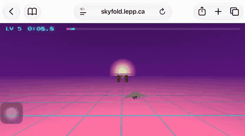

# SKYFOLD



A paper airplane flying game for mobile browsers. Tilt your
phone to dodge mid-century furniture obstacles racing toward you along a
synthwave horizon, then try to beat your best finish time.

Built with [Three.js](https://threejs.org/) r187 (vendored locally; the only
external runtime request is the Press Start 2P font from Google Fonts, which
falls back to a system font if unavailable).

## Project layout

```
index.html        entry point: markup + overlays
css/style.css      all styling (neon/synthwave theme)
js/main.js         game state machine + render loop
js/input.js        tilt / keyboard / touch-drag input, calibration
js/audio.js        synthesized chiptune title music, whoosh, crash, fanfare
js/plane.js        procedural paper-airplane mesh
js/track.js        sky, scrolling ground grid, obstacle generation & collision
js/furniture.js    mid-century furniture meshes used as obstacles
vendor/three.module.js   vendored Three.js r187 (ES module build, plus three.core.js)
deploy/flying-game.service   systemd unit for the Pi deployment
deploy/server.py             static server that sends Cache-Control: no-cache
```

## Playing

1. Open the page on a phone in landscape (portrait shows a rotate prompt).
2. Tap once to enable audio and title music, tap again to start.
3. On iOS, Safari prompts for "Motion & Orientation Access" right after that
   second tap — accept it.
4. Hold the phone roughly level during the 3-2-1 calibration — that becomes
   your neutral position.
5. Tilt left/right to strafe, tilt forward/back to dive/climb. Dodge the
   glowing barriers and furniture (bookshelves, sofas, floor lamps, sputnik
   chandeliers, plants, sunburst mirrors); fly through gold rings for a speed boost. Hitting an
   obstacle crashes you and restarts the run. Reach the checkered finish line
   to record your time — your fastest completion is saved as your best time.

**If the tilt feels backwards**, use the *invert tilt* checkbox on the title
screen.

### Fallbacks

- No motion sensor / permission denied: touch-drag anywhere on screen works
  the same as tilt.
- Desktop: arrow keys / WASD.

## Levels

The game starts at level 1. Finishing a level offers **NEXT LEVEL** or
**REPLAY LEVEL**, and there is no upper limit: level 6 follows level 5, and so
on. Crashing restarts the current level. Best times are saved per level in
`localStorage`.

Every level takes about **2 minutes** to fly. Each level flies **10% faster**
than the one before and packs in **~22% more obstacles per unit distance**
(density grows by sqrt(1.5) per level). The course gets longer in distance to
hold the clock time constant, so the number of obstacles you face grows even
faster (~34% per level). Difficulty climbs exponentially; expect it to become
impossible somewhere around level 8-10.

| Level | Speed | Obstacle density | Course length (units) | Speed x density |
|---|---|---|---|---|
| 1 | 1.00x | 1.00x | 4,591 | 1.00x |
| 2 | 1.10x | 1.22x | 5,050 | 1.35x |
| 3 | 1.21x | 1.50x | 5,555 | 1.82x |
| 4 | 1.33x | 1.84x | 6,110 | 2.45x |
| 5 | 1.46x | 2.25x | 6,721 | 3.29x |
| 6 | 1.61x | 2.76x | 7,393 | 4.44x |
| 7 | 1.77x | 3.38x | 8,133 | 5.98x |
| 8 | 1.95x | 4.13x | 8,946 | 8.06x |
| 9 | 2.14x | 5.06x | 9,840 | 10.85x |
| 10 | 2.36x | 6.20x | 10,825 | 14.62x |

To jump to levels 1-5 for testing, shake the phone (or press G) to open the
diagnostics screen and use the tiny level buttons at the bottom right. Higher
levels are reachable only by playing through.

The scaling lives in `levelScale()` in `js/track.js`, which holds
`LEVEL_SPEED_GROWTH`, `LEVEL_OBSTACLE_GROWTH` and `TARGET_SECONDS`.

## Tuning the level

`js/main.js` holds the level-1 difficulty constants at the top: `BASE_DISTANCE`,
`SPEED_MIN`, `SPEED_MAX`, `DIFFICULTY_POW`. These describe level 1 before scaling;
`levelScale()` adjusts distance, speed and density for each level, targeting
about 2 minutes. Boost rings shave time off that baseline. Obstacle density/altitude/movement rules by progress
fraction live in `generateLevel()` in `js/track.js`.

## Dependencies

There is no `package.json`; the one dependency is tracked here.

| Dependency | Version | Location | Notes |
|---|---|---|---|
| [Three.js](https://threejs.org/) | r187 (0.187.0) | `vendor/three.module.js`, `vendor/three.core.js` | ES module build, vendored. Latest release as of 2026-11-12. |
| Press Start 2P (font) | n/a | Google Fonts, loaded in `index.html` | Only external runtime request; falls back to a system font. |

To upgrade Three.js, download `three.module.js` and `three.core.js` from the
`build/` folder of the new release (e.g. via the `three` npm package), replace
both files in `vendor/` (they must stay in the same folder), and update the
version above. Confirm with `grep "const REVISION" vendor/three.core.js`.

## Hosting

I run this on a Raspberry Pi with a Cloudflare Tunnel carefully exposing it to the Internet at [skyfold.lepp.ca](https://skyfold.lepp.ca). Other simple hosting options should work fine.
